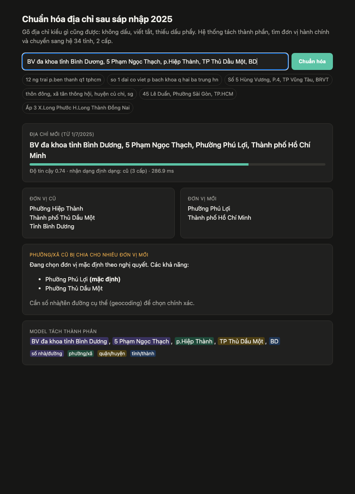

# vn-address-normalizer

[Tiếng Việt](README.vi.md)

On 1 July 2025 Vietnam merged its 63 provinces into 34 and dropped the district level entirely. That means most addresses sitting in customer databases, order histories and shipping systems now refer to units that no longer exist. And people never typed addresses cleanly in the first place: `12 ng trai p.ben thanh q1 tphcm`.

This project takes an address the way people actually type it, works out which ward, district and province it refers to, and gives it back in the new two-level system.

```
$ vnaddr "Số 1 Đại Cồ Việt p bach khoa q hai ba trung hn"
old: Phường Bách Khoa, Quận Hai Bà Trưng, Thành phố Hà Nội
new: Số 1 Đại Cồ Việt, Phường Bạch Mai, Thành phố Hà Nội
confidence: 1.0
```



It handles addresses in the old format (ward, district, province) and in the new one, and says which it saw. When an old ward was split between several new wards, it returns the official default and lists the other candidates instead of pretending to know.

## Results

What I measure is ward accuracy: did we land on the right new ward and province?

| | Synthetic test | Synthetic, hard | Real-style test |
|---|---|---|---|
| [vietnamadminunits](https://github.com/tranngocminhhieu/vietnamadminunits) (rule-based library) | 89.3% | 75.2% | 86.6% |
| Rule-based splitter + my resolver | 75.6% | 73.1% | 84.8% |
| **Fine-tuned XLM-R + my resolver** | **98.7%** | **98.0%** | **99.6%** (223/224) |

The synthetic test set (5,000 addresses) comes from my generator with an unseen seed. The hard variant (3,000) has typos in 35% of the addresses and no accents in 70%. The real-style test set has 224 addresses of real places (homes, shops, schools, hospitals, UBND offices) written the way people fill in delivery forms. I made it after every design decision was final and ran it once.

I ran `vietnamadminunits` offline, like my system, and told it whether each address was in the old or new format, since it can't detect that by itself. That setup favours it. Speed is where it wins: it takes 1–3 ms per address, mine takes 55–80 ms on a laptop CPU.

An LLM wrote the real-style sets and I checked every label against the official list of units. [data/eval/README.md](data/eval/README.md) has the details. They are not production data, so I'd expect lower numbers on a real customer database.

## How it works

There are two steps.

**1. Split the address into parts.** An `xlm-roberta-base` model (277M parameters), fine-tuned for token classification, labels each word as street detail, ward, district or province. Rules give up quickly here: commas are optional, `P.` can be a ward prefix or part of a name, and plenty of addresses start with something like "BV đa khoa tỉnh Bình Dương", which contains a province that isn't the address's province. This step is where the errors come from. Given the correct split, the rest of the pipeline gets 98.8% on the synthetic test set; with a rule-based splitter it gets 75.6%.

**2. Resolve and convert.** Each part is matched against 10,040 pre-2025 units and 3,321 post-2025 units. The matching copes with abbreviations (`P.`, `F.`, `Q1`, `TX.`, `TT.`), typos, missing accents, names that start like a prefix ("Phương Mai" is not "Phường Mai"), short province names (`SG`, `HN`, `BRVT`, and `ĐN`, which can mean two provinces) and names from the mergers between 2019 and early 2025. It scores the old-format and new-format readings together. When the province looks wrong it searches the whole country, and when no ward was labelled it looks inside institution names ("UBND xã Kim Chung, Đông Anh, HN"). The result is then converted with the official old-to-new mapping, which covers every old unit.

The unit lists and the mapping come from the [vietnamadminunits](https://github.com/tranngocminhhieu/vietnamadminunits) package (MIT); `scripts/build_gazetteer.py` turns them into `data/gazetteer.json`.

### Training data

There is no public labelled dataset of messy Vietnamese addresses, so I wrote a generator (`src/vnaddr/synth.py`) and trained on 200k of its addresses. It strips accents, mixes casing, uses a dozen spellings for each unit type, drops or changes separators, adds typos, ngõ/ngách/hẻm/kiệt, thôn/ấp/tổ and building names, and puts shop and institution names in front.

Training ran on a free Kaggle T4: about 25 minutes for XLM-R and 12 for DistilBERT (`kaggle/train_tagger.py`).

## Mistakes along the way

The first model scored 98% on synthetic data but only 80% on my real-style dev set. Real addresses often start with a place name ("Chợ Bến Thành, …", "BV đa khoa tỉnh Vĩnh Phúc, …"), my generator never produced one, and the model happily tagged hospital names as provinces. Adding place names to the generator fixed most of it.

Then I tried a fresh real-style set and got 88.9%, a bit below the rule-based library on the same set (89.8%). I had tuned the resolver on my dev set until it looked perfect, and that didn't carry over. 18 of the 25 errors had the same shape: "UBND xã X, huyện Y" or "Công an phường X, quận Y", where the ward only appears inside an institution name. I fixed that in the resolver and in the generator. Since I had now looked at that set's errors, it became a second dev set, and I wrote a third one for the final number. The intermediate numbers are in [reports/history.md](reports/history.md).

Here is what each change to the training data did, measured with the same resolver on the final test set:

| Model | Training data | Real-style test |
|---|---|---|
| XLM-R v1 | addresses only | 83.9% |
| XLM-R v2 | + place names in front, province initials | 98.7% |
| XLM-R v3 | + wards inside institution names | 99.6% |
| DistilBERT-multilingual v3 (135M) | same as v3 | 99.6% |

DistilBERT is about twice as fast and nearly as good on the synthetic sets (98.6% and 97.9%), so it's a fair choice when speed matters.

The main results, including the dev sets, are in `reports/results.json`. The per-version runs from the table are in `reports/results_v*.json`, and the remaining errors are in `reports/errors/`.

## Running it

```bash
python3 -m venv .venv
.venv/bin/pip install -e ".[model]"     # or just -e . for the rule-based fallback, no torch
```

The model isn't in the repo. Put a trained tagger in `models/tagger/`, as explained in [models/README.md](models/README.md). Without one everything still runs on the rule-based splitter, which is a lot weaker, and the CLI prints a warning.

```bash
# one address (add --json for the full result)
.venv/bin/vnaddr "12 ng trai p.ben thanh q1 tphcm"

# a CSV file: adds vnaddr_* columns next to yours
.venv/bin/vnaddr --csv customers.csv --column address --out customers_2025.csv

# HTTP API + the web demo at http://localhost:8000
.venv/bin/uvicorn vnaddr.api:app --port 8000
curl -s localhost:8000/normalize -H 'Content-Type: application/json' -d '{"address": "Q.BT, P.25, SG"}'

# Docker (copies models/ into the image)
docker build -t vnaddr . && docker run -p 8000:8000 vnaddr
```

`POST /normalize` takes `{"address": "..."}`, and `POST /normalize/batch` takes `{"addresses": [...]}` (up to 1,000). `GET /health` tells you which tagger is loaded. A result looks like this:

- `new`: province, ward and the full new address
- `old`: the old ward, district and province, when the input was in the old format
- `fmt`: `old` or `new`, whichever the input looked like
- `split_ward` / `alternatives`: whether the old ward was divided, and the candidate new wards if so
- `confidence`: 0 to 1. For a bulk migration I'd send anything under about 0.7 to manual review.
- `spans`, `street`: how the input was split

### Reproducing the numbers

```bash
.venv/bin/pip install -e ".[model,dev]"
.venv/bin/python scripts/gen_data.py      # ~2 min, ~130 MB in data/synth/
# train on Kaggle, see kaggle/README.md, and copy the model to models/tagger/
.venv/bin/python scripts/evaluate.py --out reports/results.json --errors reports/errors
.venv/bin/python scripts/make_report.py
.venv/bin/python -m pytest -q
```

Without a model in `models/tagger/`, `evaluate.py` skips the model rows (it says so) and the file it writes has only the baselines.

## Limitations

- 471 old wards were divided between several new ones. Picking the right one needs the location of the house, so without a geocoder you get the official default plus the list.
- "P.5" isn't matched yet to wards whose official name is "Phường V". That's the one error on the final test set.
- Names older than the merger history in the unit lists won't resolve.
- Dynamic int8 quantization makes the model about 1.4× faster on CPU but costs 8 points of tag accuracy ([reports/int8_check.md](reports/int8_check.md)), so it's off by default.

## Layout

```
src/vnaddr/     text, gazetteer, synth (data generator), tagger, resolver, pipeline, api, CLI
scripts/        build_gazetteer, gen_data, evaluate, make_report, build_real_eval, int8_check
kaggle/         GPU training job + metadata templates
data/           gazetteer.json, eval/ (real-style test sets)
reports/        results, errors per set, training metrics, history
web/ docs/ tests/
```

## License

MIT. The administrative unit data comes from [vietnamadminunits](https://github.com/tranngocminhhieu/vietnamadminunits) (MIT).
